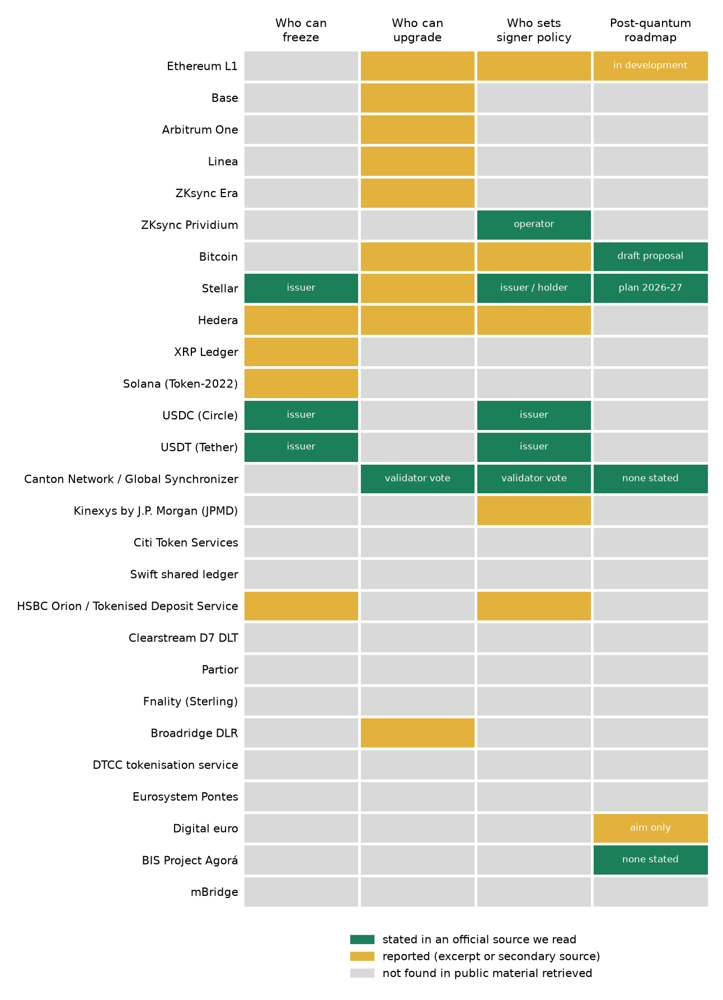
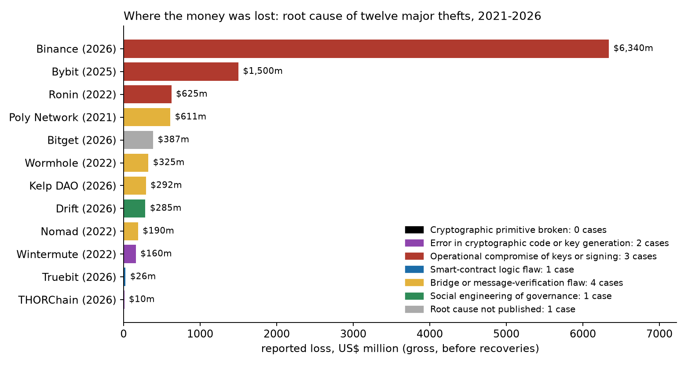

# Chapter 2 — final text for Substack

## Headline options

1. Would a Faster 3-SAT Algorithm Break the Blockchain?
2. From 3-SAT to the Ledger: Consensus, Signatures and Proofs Stand
3. 3-SAT Meets the Ledger: Sound Mathematics, a Dual-Use Twist

## Subtitle options

1. Layer by layer (consensus, signatures, zero-knowledge proofs, smart contracts), the October results leave the mathematics standing. The twist is in verification.
2. I set today's best SAT solvers on the hash behind Bitcoin, then asked the same question of every layer of a ledger.
3. Why the AI-generated 3-SAT results leave blockchain cryptography standing, why contract-verification tools are the exception, and what authorities should ask.

---

*TL;DR: On current knowledge, a much faster algorithm for 3-SAT would not weaken the consensus, signatures or zero-knowledge proofs that blockchains rely on, because none of them rests on the hardness the October results address. The one place where SAT solving matters directly is smart-contract verification, where any practical advance would help defenders and attackers alike. What blockchains do change is the consequence and the remedy when an assumption weakens: the record is permanent, and replacing a primitive is a governance decision. That is where authorities' questions should go.*

---

The code, tests and results behind this piece are public on [GitHub](https://github.com/HiCarC/crypto-assumptions-fmi-blockchain): the SAT experiments, a reference settlement system with its formal proofs, and a 21-page technical annex, tested on an Ethereum-style (EVM) ledger, Stellar and Canton. Every number below can be checked there.

I wanted to see what today's tools can do before asking what a better algorithm might do. So I took SHA-256, the hash function behind Bitcoin, and gave three of the best SAT solvers available, programs that search for values satisfying a set of logical constraints, almost all of an input. I hid only a dozen bits and asked them to recover those bits from the output.

They took up to a minute. A plain search through all 4,096 possibilities finds them in milliseconds. With 16 bits hidden, they found one answer in nine attempts within two minutes.

Size is part of the story. Written as a SAT problem, one SHA-256 computation became about 72,000 variables, not 256. That is the lesson Chapter 1 drew for AES: what matters is the size of the encoded problem, not the size of the key.

*Figure: Time for three current SAT solvers (Kissat, CaDiCaL, CryptoMiniSat) to recover hidden input bits of the full SHA-256 function, the rest of the input being given. Three random instances per point; 120-second limit; x = not found. At 16 bits, one answer in nine attempts; at 20 bits only one solver was tried. One encoding of my own, on one machine; it describes today's tools, not future algorithms.*

## The promise from Chapter 1

In [Chapter 1](https://thekarlc.substack.com/p/ai-3sat-eth-refutation-banking-cryptography) I looked at the AI-generated results from OpenAI and Anthropic that, if correct, overturn the Exponential Time Hypothesis for 3-SAT. I found an extraordinary result but no newly feasible attack, and I proposed a test: show me the attack, the system and the resources.

I also promised to examine what happens when cryptographic assumptions underpin public consensus, digital signatures, zero-knowledge proofs and smart-contract execution, and whether the October results create a different security problem for blockchain-based financial infrastructure. This chapter keeps that promise, one layer at a time.

## One question, four layers

The question is the same for each layer: would a much faster algorithm for 3-SAT and #3-SAT change anything here?

For each layer I ask what it relies on, whether that rests on the hardness the hypothesis describes, what my tests found, and what remains uncertain.

## Consensus

Consensus is how a ledger's participants agree on one history. The ledgers that matter for finance use proof of stake, proof of authority or Byzantine-fault-tolerant protocols: validators sign each block, and a block is final once enough of them have signed. Those signatures are BLS signatures on the BLS12-381 curve in Ethereum's case, and often Ed25519 in permissioned ledgers. Every one of these ledgers also links its records with hash functions such as SHA-256.

Neither rests on the hardness the October results address. As I read the published analyses, a hash function's security is a judgement about the best known attacks on that specific function, and signatures rest on problems in elliptic-curve mathematics.

My tests at the start of this piece show where generic SAT solving stands against the full hash. The best published attack on reduced SHA-256 that I could read in full, by [Khovratovich, Rechberger and Savelieva](https://eprint.iacr.org/2011/286), finds inputs for 45 of its 64 steps, and still costs almost as much as trying every input.

The residual is narrow. A practical method for reversing a hash faster than plain search would matter for every ledger. Neither paper offers one.

## Digital signatures

Every transfer on a ledger is authorised by a digital signature, almost always based on elliptic curves. Their security rests on the difficulty of the elliptic-curve discrete-logarithm problem.

That problem is not believed to be among the hardest problems that 3-SAT stands for, and its security estimates do not come from the hypothesis. In principle it can be rewritten as a SAT formula, but the formula would be far larger than my SHA-256 one. As far as I can see, the claimed speed-up leaves that route far slower than the attacks already known.

The real long-term threat to these signatures is a large quantum computer, which is a different question with a different timetable.

## Zero-knowledge proofs

Zero-knowledge proofs let one party convince another that a statement is true without revealing why. Ledgers use them for privacy, and to compress the checking of many transactions into one proof.

Their soundness rests on other assumptions: discrete-logarithm and related curve problems, collision-resistant hashing, assumptions about what a prover must know, and treating a hash function as a source of randomness. None of these is the hardness the October results address.

There is one genuine nuance. OpenAI's paper also gives a faster way to invert functions in which each output bit depends on only a few input bits. It notes that this applies to such versions of Oded Goldreich's candidate one-way functions, and adds that it does not rule out their being hard for efficient attackers.

Generators of that local kind are one of the assumptions behind a 2020 research construction of program obfuscation, by [Jain, Lin and Sahai](https://eprint.iacr.org/2020/1003). Whether the October result matters there depends on how much hardness the construction assumes, and I found no published analysis. I found none of these constructions in production use.

The zero-knowledge failures that have actually occurred were implementation bugs: circuits that failed to constrain what they should, and flawed implementations of the step that turns an interactive proof into a single message.

## Smart-contract execution

Here is the twist. The mathematics of contract execution is not at stake, but the tools that check contracts are built on solvers of the same family.

Certora's prover, for example, compiles a contract and the rules it must obey into a logical formula, "which is then proved or disproved by an SMT solver", a richer descendant of SAT solving. Bug-finding tools work in a similar way, looking for an input that breaks a rule.

In this project I used Certora and a second tool, Halmos, on a reference settlement system. Taking the signature checks themselves as given, Certora proved, for every possible state of the token, five things:

- no transfer happens without a valid signature;
- each authorisation works only once;
- supply changes only through issuance and redemption;
- nothing moves while the system is paused;
- privileged functions refuse unauthorised callers.

Halmos proved that a delivery-versus-payment settlement moves both legs or neither, whatever the amounts.

A genuinely faster solver would make this kind of assurance cheaper. It would also make it cheaper to search other people's contracts for flaws. That is a dual-use shift, and it would favour whoever adopts it first.

The October results are about how running time grows as problems become arbitrarily large. As I read them, they do not come with a faster solver for problems of the size these tools handle. The twist is a direction to watch, not a change today.

## A different security problem?

Not from the mathematics. But blockchains do change two things when a cryptographic assumption weakens: the consequence and the remedy.

The consequence is larger because the assumptions are public and the record is permanent. Every signature, and every public key revealed by spending, stays on the ledger for anyone to attack later.

The remedy is harder because replacing a primitive is a governance decision. It needs a protocol upgrade, or a migration of every account, decided by whoever can change the ledger's rules. In my tests, holders who never migrated kept their balances but could no longer sign, and only a privileged registrar could bring them back.

So three powers matter alongside the mathematics: who can change the rules, who can freeze an asset, and who decides which keys count. For 14 institutional and central-bank platforms I examined, I recorded 47 of 56 answers on those powers and on post-quantum plans as not found in public material.

*Figure: Who holds the powers, by platform. Green: stated in an official source I read. Amber: reported in a secondary source. Grey: not found in public material, which is not evidence of weakness.*

Losses so far confirm where the risk sits. According to Binance's own report, the attack that affected about US$6.3 billion of its assets in October went through unauthorised use of an internal signing service, and Binance said it found no evidence that any wallet's private key had leaked. The signatures were valid; the operations around them failed.

*Figure: Twelve major thefts, 2021–2026, by root cause as reported. A selection of large cases, not a census.*

## What authorities should ask

1. Which cryptographic primitives does each layer of this ledger depend on (consensus, account signatures, any proof system, contract code), and on which assumptions?
2. Who tracks developments in cryptanalysis for each of them, as DORA's technical standard already requires of financial entities, and who would decide on a replacement if one weakened?
3. How quickly could a replacement be deployed, and what would happen to holders who do not act?
4. Are the contracts that hold settlement assets formally verified, against which properties, and with which tools?
5. Who can change the ledger's rules and the contracts' code, with what delay, and who can freeze or reverse a transfer of each settlement asset?
6. Which of these answers are written down, and who outside the operator can read them?

Chapter 1 asked for the newly feasible attack before discussing a change in risk. For a ledger, first ask which assumption each layer rests on and who could replace it in time; only then discuss the mathematics.

*If this was useful, subscribe: the series on AI, cryptography and financial stability continues.*

---

**Technical annex:** [link to annex PDF, pending author approval]
**Repository:** [link pending author approval; currently private]

**Primary sources**

- OpenAI, *The Exponential Time Hypothesis is False*, preprint, 25 October 2026 (Appendix C on constant-locality maps): https://github.com/openai/math/tree/main/preprints/The-Exponential-Time-Hypothesis-is-False-October-25-2026
- Anthropic, *A 2^{o(n)} Time Algorithm for 3-SAT*, preprint, 27 October 2026: https://hexagonmath.org/2610.00577v1
- D. Khovratovich, C. Rechberger, A. Savelieva, *Bicliques for Preimages: Attacks on Skein-512 and the SHA-2 Family*, FSE 2012 (IACR ePrint 2011/286): https://eprint.iacr.org/2011/286
- O. Goldreich, *Candidate One-Way Functions Based on Expander Graphs*, ECCC TR00-090, 2000: https://eccc.weizmann.ac.il/report/2000/090/
- A. Jain, H. Lin, A. Sahai, *Indistinguishability Obfuscation from Well-Founded Assumptions*, IACR ePrint 2020/1003: https://eprint.iacr.org/2020/1003
- S. Chaliasos et al., *SoK: What Don't We Know? Understanding Security Vulnerabilities in SNARKs*, USENIX Security 2024: https://arxiv.org/abs/2402.15293
- Trail of Bits, *Coordinated disclosure of vulnerabilities affecting Girault, Bulletproofs, and PlonK* ("Frozen Heart"), April 2022: https://blog.trailofbits.com/2022/04/13/part-1-coordinated-disclosure-of-vulnerabilities-affecting-girault-bulletproofs-and-plonk/
- Certora Prover documentation: https://docs.certora.com/en/latest/docs/user-guide/
- Halmos, symbolic testing for EVM smart contracts: https://github.com/a16z/halmos
- Binance, *29 October 2026 Binance Security Incident: Initial Findings and Response Update*, 3 November 2026: https://www.binance.com/en/blog/community/3229153443759566763
- Commission Delegated Regulation (EU) 2024/1774, DORA technical standard on ICT risk management: https://eur-lex.europa.eu/eli/reg_del/2024/1774/oj

---

*Carles Cerqueda*

*Independent commentary on financial stability, market infrastructures and emerging technologies. Views are personal and do not represent any current or former institution.*

---

## SEO

- **SEO title (≤60):** Would Faster 3-SAT Break the Blockchain? Layer by Layer
- **Meta description (≤155):** Consensus, signatures and zero-knowledge proofs survive the October 3-SAT results; contract verification is the twist. What authorities should ask.
- **Slug:** faster-3sat-blockchain-security-layer-by-layer
- **Tags:** blockchain, cryptography, 3-SAT, exponential time hypothesis, zero-knowledge proofs, formal verification, financial market infrastructure, tokenisation
