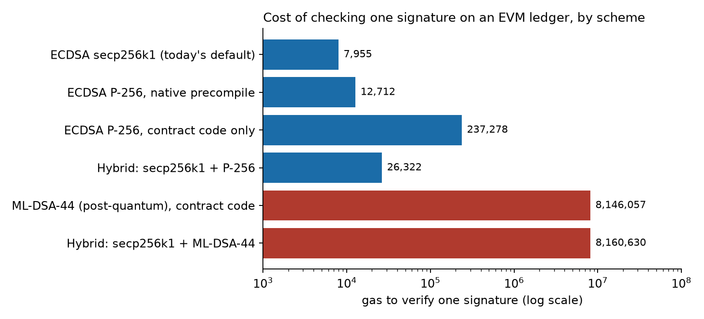
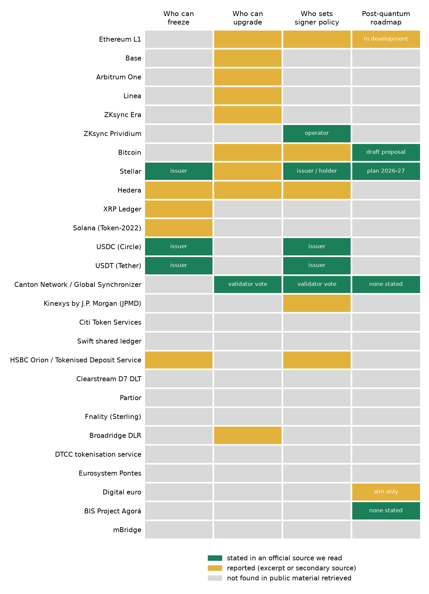
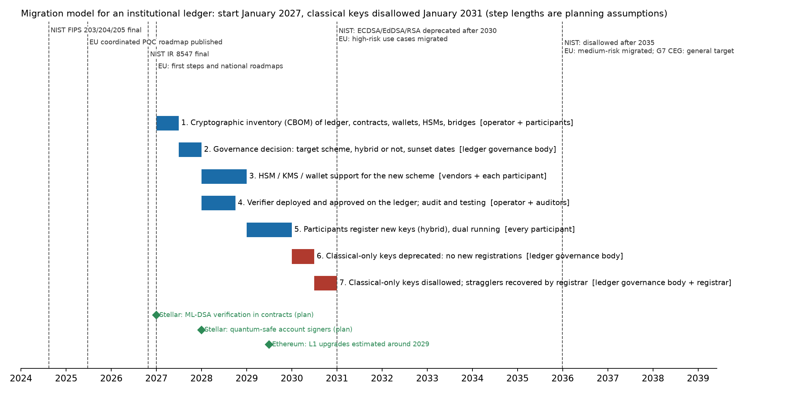

# How to read this annex

This annex documents the research, the code, the tests and the findings behind Chapter 2. It is written for CTOs, CISOs, architects, auditors and the technical teams of authorities. Every quantitative statement points to a file in the companion repository that reproduces it, or to a claim in `CLAIMS.md` with its evidence label:

- **V**: verified against a primary source read for this project, or reproduced by code in the repository;
- **R**: reported by a credible secondary source, or seen only as an official excerpt;
- **I**: our inference, with the reasoning written out;
- **U**: not found in the public material retrieved.

"Not found in public material" means exactly that: a time-boxed search on 15 November 2026 did not find it. It is never a claim that something does not exist, has not been done, or is weak. The limits of the work are set out in section 12 and in `LIMITATIONS.md`.

# 1. Summary

1. **The October 2026 results do not reach deployed blockchain cryptography.** The signature schemes, hash functions and proof systems used by blockchains are not protected by the hypothesis those results address. The results remain unrefereed (section 2).
2. **The mathematics held in every major loss we examined; the losses came from the powers around it.** In the largest theft on record (Binance, October 2026) the signatures were valid. An internal signing service was used to authorise a delegation that a protocol upgrade had made possible (section 4).
3. **The spine: four powers decide what a ledger's cryptography is worth.** They are who can instruct the signer, who can change the rules (upgrade), who can freeze or reverse, and who can say which keys count (registrar). For most institutional ledgers we examined, who holds these powers is not found in public material (sections 3 and 7).
4. **The second pillar: post-quantum agility has a measurable price.** Verifying one ML-DSA-44 signature in EVM contract code costs about 8.1 million gas, roughly a thousand times ECDSA. Application-level agility also stops at the ledger's own transaction signature (sections 5 and 6).
5. **Attacker capability changed more than mathematics did.** AI agents now exploit vulnerable smart contracts in benchmarks at a stated cost. On the Chapter 1 test (a newly feasible attack, the system affected, the resources required) this shift qualifies; the October results do not (section 8).

# 2. The October 2026 results, re-verified

**Status as of 15 November 2026.** OpenAI's preprint *The Exponential Time Hypothesis is False* is dated 25 October 2026 and has not been revised since it was posted (A1, V). Its Lean formalisation proves a slightly weaker bound than the manuscript states. For fixed clause width *k*, the Lean statement gives exact counting of satisfying assignments in time

$$ (L+1)^{O_k(1)} \cdot 2^{O_k\left(n\,(\log\log n)^2/\sqrt{\log n}\right)}, $$

where *L* is the length of the encoded formula. The manuscript claims a single log log n factor in the exponent. Both bounds are subexponential: the exponent grows more slowly than any fixed fraction of the number of variables *n*. If either holds, ETH is false (A2, V). Anthropic's paper claims a deterministic subexponential algorithm for 3-SAT and #3-SAT in a single version dated 27 October 2026 (A3, V). Independent experts are examining the OpenAI result; no confirmation and no refutation has been published (A4, R).

**What the hypothesis is about, in words.** ETH says that some fixed fraction of the variables must be "paid for" exponentially when solving 3-SAT in the worst case. Refuting it means that the worst case grows a little more slowly than that. It is a statement about growth as problems become arbitrarily large. It says nothing direct about how long any particular instance takes, and nothing at all about problems that are not reduced to SAT.

**Does it reach blockchain cryptography?** We consider each assumption a ledger relies on (A5, I):

- *Elliptic-curve signatures* (secp256k1, P-256, Ed25519) and *pairings* (BLS12-381, BN254). Their security levels come from the best known algorithms for the specific algebraic problem: Pollard's rho method for discrete logarithms, number-field-sieve variants for pairing target groups. These problems are not known to be NP-hard, and their security estimates are not derived from ETH. One could write a discrete-logarithm instance as a Boolean circuit and then as a SAT formula. The claimed running time is subexponential in the number of variables *of that formula*, which for a 256-bit scalar multiplication runs to hundreds of thousands. That is far more than the 128 bits that bound the generic attack. Chapter 1 made the same argument for AES.
- *Hash functions* (SHA-256, Keccak-256, SNARK-friendly hashes such as Poseidon). Their security is a cryptanalytic judgement about a fixed function, not a consequence of ETH. SAT solvers are a real cryptanalytic tool, and section 9 measures how far they get today.
- *Lattice-based post-quantum schemes* (ML-DSA, ML-KEM). Their parameters are set with concrete cost models for lattice reduction. Some *conditional lower bounds* for lattice problems are proved assuming ETH or its strong variant. If ETH is false, those particular arguments lose their premise. The main results are by Bennett, Golovnev and Stephens-Davidowitz (FOCS 2017) and by Aggarwal and Stephens-Davidowitz (STOC 2018). They show that, unless SETH or a gap version of ETH fails, the closest-vector and shortest-vector problems cannot be solved much faster than exponentially in some norms. Neither covers the closest-vector problem in the Euclidean norm, which is what the schemes use, and the shortest-vector result in that norm needs an extra unproven hypothesis (V). All of these are worst-case, asymptotic statements. ML-DSA's parameters were instead chosen from concrete cost models of the best known lattice-reduction attacks: the Dilithium specification reports "Core-SVP" estimates per parameter set (V). If ETH is false, these conditional lower bounds lose their premise. That removes a piece of supporting theory; it supplies no attack, and it does not touch the cost models on which the parameters rest.
- *Zero-knowledge proof systems.* Soundness of deployed SNARKs and STARKs rests on algebraic assumptions in pairing groups or on collision-resistant hashing, on knowledge-type assumptions or idealised group models, and on the random-oracle heuristic for the Fiat–Shamir transform. None is an ETH-type assumption. Where ZK systems have failed in practice, they failed in implementation. A systematic study of 141 SNARK vulnerabilities from 2018 to 2024 found 99 in circuits, of which 95 were under-constrained circuits: a circuit that accepts witnesses it should reject (Chaliasos et al., USENIX Security 2024; V). Trail of Bits' 2022 "Frozen Heart" disclosure showed that insecure implementations of the Fiat–Shamir transformation let attackers forge proofs in implementations of Girault's proof, Bulletproofs and PlonK (V).
- *Constructions that do rest on fine-grained hardness.* These include proofs of useful work based on Orthogonal Vectors or 3SUM, and the local pseudorandom generators behind some indistinguishability-obfuscation results. They would be directly affected. No production use in a blockchain or financial system was found (A7, R/U). Goldreich-type local generators are, in addition, under separate cryptanalytic pressure published in 2026.

**Conclusion for section 2.** On the evidence available, the October results change the theory of computation, not the security of any deployed ledger. This is conditional on the results standing, and on no new reduction appearing that links them to a deployed primitive.

# 3. The spine: four powers

A blockchain is often described as immutable. For tokenised money and securities that is not a property of the ledger; it is a property of each asset, set by who holds four powers:

| Power | What it decides | Where the Binance and Bybit cases touched it |
|---|---|---|
| **Signer policy** | Which messages a key will sign, for whom, under what limits | Binance: a signing service signed an authorisation type its policy did not anticipate. Bybit: signers approved bytes that differed from what their screen showed |
| **Upgrade** | What the code, and therefore a signature, means | Binance: a protocol upgrade (EIP-7702, May 2025) gave a signed authorisation a new meaning |
| **Freeze and reversal** | Whether a theft is final | Binance: about US$2.85 billion was frozen or intercepted, because some assets have issuers with freeze powers |
| **Registrar** | Which keys count, and how a lost or broken key is replaced | The remedy when a scheme fails, and also a single point of control (section 6) |

These are cryptographic powers in a precise sense: each decides whether a valid signature results in a valid transfer. They are also governance powers, which is why the question of who holds them belongs to supervision as much as to engineering.

The reference system in the repository makes each power explicit, as a separate role in an access manager (`docs/threat-model.md` §2). The Daml model (`daml/`) shows the contrast on Canton-style ledgers. In Daml, the signatories of a contract are the parties with the power to create and archive it, and archiving needs the authority of every signatory (Canton documentation; V). So freeze and claw-back exist only if they are written into the contract the holder signed, and a holding signed by issuer and owner cannot be archived by either alone (6 tests). Code changes follow a different route from the EVM's proxy upgrades. A new package version must pass upgrade-compatibility checks when it is built and again when each participant uploads it. The documentation describes no separate authorisation ceremony beyond that upload by each participant (V). Who decides to upload is therefore each participant node's operator, which places the upgrade power with the node operators rather than with a single administrator key.

# 4. Where losses happen

**The case that opens the chapter.** On 29 October 2026 about US$6.34 billion in digital assets were affected at Binance (B1, V). Binance's own report of 3 November 2026 states three things. The attacker made unauthorised use of an internal wallet signing service. The attacker exploited Ethereum's EIP-7702 authorisation mechanism to give an attacker-controlled contract execution rights over a hot wallet (B2, V). And because the wallet used multi-party computation, no single private key existed with which to revoke the authorisations at once (B3, V). Binance's update of 30 October says it found no evidence that wallet private keys were leaked (B4, V). The same report says an internal AI tool was used to gain control of an engineer's access, without explaining how (B6, V). About US$2.85 billion was frozen or intercepted (B5, V). Which issuers froze funds is reported by third parties, not by Binance (B8, R). The FBI attributed the theft to a North Korean group, according to press reports of an alert we could not open (B7, R).

**From an exchange to an FMI.** An exchange is not an FMI, and the article does not treat it as one. The relevant point is structural. Institutional tokenisation uses the same building blocks: hot and warm wallets, signing services in front of HSMs or MPC clusters, policy engines, and EVM-compatible ledgers that change through protocol upgrades. A tokenised-deposit platform or a DLT settlement system has a signer policy, an upgrade path, a freeze power and a registrar. The Binance case shows what happens when the first two are out of step.

**The pattern across incidents.** No incident in our list, which covers 2021–2026, came from a broken cryptographic primitive (`data/incidents.csv`, `results/fig_incidents.png`). The list is a selection of large and instructive cases, not a census, so it is not used to compute shares. Industry-wide figures point the same way. TRM Labs counted 207 hacks in the first half of 2026, about US$972 million stolen. Infrastructure compromises were about 15% of incidents and about 76% of losses (B13, V). Chainalysis put thefts from January to early December 2025 at over US$3.4 billion (B12, V).

Two incidents in the list are rooted in cryptographic *code* or key generation rather than operations. THORChain (2026, about US$10 million): a threshold-signature library never verified a Paillier modulus, which let a malicious node reconstruct a key (B14, V). Wintermute (2022, about US$160 million): the firm said the key had most likely come from a vanity-address tool with a small seed space (B15, V). Both are failures of implementation. Neither breaks the mathematics. Both are small next to the operational cases.

**Demonstrations.** `docs/demos.md` reproduces six failure patterns on a local chain with contracts written for the purpose. Two show "valid signature, wrong instruction":

- *Bybit pattern.* Signers see a routine transfer and sign a delegate-call that replaces the wallet's code. An on-chain guard that refuses unapproved delegate-calls stops it.
- *Binance pattern.* A signing service that authenticates the caller but not the request is asked to sign 32 bytes. Those bytes are an EIP-7702 authorisation, built as the specification defines it. The account's code becomes a delegation to the attacker's contract, and the balance is drained. The key never leaves the service. A service that only accepts typed requests (asset, allow-listed destination, limit) and has no raw-digest endpoint gives the same authenticated attacker nothing to abuse (C7, V).

The other four (replay, malleability, bridge verification, weak keys) show older patterns. In none of the six does the mathematics fail.

Table 4.1: Failure-mode demonstrations (local test chain only).

| # | Pattern (real-world case it mirrors) | What broke | Was mathematics involved? | Control that prevents it | Question that would have caught it |
|---|---|---|---|---|---|
| 1 | Signature replay | A signed payment order carried no nonce, chain or contract identifier, so one approval paid out ten times and on a second deployment | No | Bind every signed instruction to chain, contract and a single-use nonce (as `SettlementToken.transferWithAuthorization` does) | What makes each signed instruction unique, and where is that enforced? |
| 2 | Signature malleability; `ecrecover` returning the zero address | The same order had two valid encodings and replay was tracked by signature bytes; separately, an unset signer matched the zero address returned for garbage input | A documented property of ECDSA, not a break | A maintained signature library; replay keyed on the message | Is signature checking done by an audited library, and what is the replay key? |
| 3a | Compromised signing interface (Bybit, February 2025) | Signers saw a routine transfer and signed a call that replaced the wallet's code. Every signature was genuine | No | Independent display of what is signed; on-chain guard refusing delegate-calls to unapproved targets | Can signers see, on a device the web interface does not control, exactly what they authorise? |
| 3b | Signing service with no policy on message type (Binance, October 2026) | An attacker inside the network asked the signing service to sign 32 bytes. They were an EIP-7702 authorisation, which made the hot wallet run attacker code. The key never left the service | No | Typed signing requests only; no raw-digest endpoint; allow-lists and limits; policy reviewed at every protocol upgrade | List every message type your signer will sign. Who updated that list after the last protocol upgrade? |
| 4 | Bridge accepting unproven messages (Nomad and Wormhole, 2022) | An upgrade made the "no proof" value count as proven; in the second variant the caller supplied its own verifier | No | Negative tests after every upgrade; verifier identity fixed in code | Which test shows that a message with no valid attestation is rejected, and when was it last run? |
| 5 | Weak key generation (Profanity pattern, 2022) | The key came from a seed space small enough to enumerate (16 bits here, deliberately tiny), so the public address alone revealed it | The curve was not attacked; the search space was small | Keys generated in certified hardware or audited libraries from proper entropy | Where was each signing key generated, by what software, from what entropy? |

# 5. The second pillar: what post-quantum agility costs on an EVM ledger

**Method.** The repository measures, in the same contract and test harness, the gas cost of verifying one signature with each scheme, and the full cost of a signed token transfer (`contracts/test/PostQuantum.t.sol`, `scripts/gas_table.py`). ML-DSA-44 (FIPS 204) is verified by a third-party Solidity implementation (ZKNoxHQ/ETHDILITHIUM, pinned commit) that its authors describe as experimental and unaudited. It is used here to measure cost, not as a recommendation. Signatures come from that project's reference signer with a public test seed.

**Results** (`results/gas_table.md`, C1–C3, V):

| Verification mode | Public key | Signature | Gas to verify | Relative to ECDSA |
|---|---|---|---|---|
| ECDSA secp256k1 (today's default) | 20 B (address) | 65 B | 7,955 | 1× |
| ECDSA P-256, native precompile | 64 B | 64 B | 12,712 | 2× |
| ECDSA P-256, contract code | 64 B | 64 B | 237,278 | 30× |
| Hybrid secp256k1 + P-256 | 84 B | 288 B | 26,322 | 3× |
| ML-DSA-44, contract code | 1,312 B | 2,420 B | 8,146,057 | about 1,000× |
| Hybrid secp256k1 + ML-DSA-44 | 1,332 B | 2,656 B | 8,160,630 | about 1,000× |

A complete signed transfer costs about 146,000 gas with ECDSA and about 8.3 million with ML-DSA-44. On a block of 30 million gas, a round reference figure, that is about 205 transfers against about 3. Registering one ML-DSA public key, which this implementation stores in an expanded 22,400-byte form, costs about 5.3 million gas once.



**How to read this.** The cost is an artefact of verifying in contract code. The P-256 rows show the same effect for a classical scheme: a native precompile is about twenty times cheaper than contract code. Ethereum has proposals for ML-DSA and Falcon precompiles (EIP-8051, EIP-8052), and Stellar plans ML-DSA verification as a native host function (D10, D11). The same authors report an experimental optimised variant at about 1.2 million gas, which we did not measure. The result is therefore not "post-quantum is unaffordable". It is this: **on today's EVM, post-quantum agility depends on a protocol change that only the ledger's governance can make.** That brings the question back to the spine.

# 6. Agility as governance: the reference system

**Design.** The token and the DvP contract never check signatures themselves. They ask a key registry whether a signature is valid for an account. The registry holds, per account, a pair (verifier contract, key), and governance moves each verifier through a life cycle borrowed from NIST IR 8547's vocabulary: Approved, then Deprecated (still verifies, no new registrations), then Disallowed (verifies nothing). Status only moves forward. Every change of status passes through a two-day timelock.

**What the tests show** (C4–C6, V):

1. A participant can move from secp256k1 to P-256, or to a hybrid of ECDSA and ML-DSA, with one signed rotation, and **no balance moves**.
2. When a scheme is disallowed, holders who did not migrate **keep their balances but can no longer sign**. Their old key cannot even authorise its own replacement. Only the registrar can restore them. That is the answer to "what happens to assets whose holders do not migrate", and it makes the registrar both the remedy and a single point of control (audit finding M-2).
3. **Agility at the application layer stops at the ledger's own signature.** The token still accepts ordinary transfers authorised by the ledger's native transaction signature (ECDSA on Ethereum). Retiring ECDSA in the registry does not stop a holder's account from moving tokens. Only the ledger, or contract accounts whose validation follows the registry, can close that path (audit finding M-1). On Soroban, contract accounts close it, and the account keeps its address when its scheme changes (`soroban/account`, 3 tests). Classic Ed25519 accounts on Stellar remain as they are.

**Verification.** The six critical properties are listed below; table 4.2 of `audit/report.md` shows which technique covers each. Fuzzing, invariant testing and Echidna cover all six; Halmos checks four symbolically; the Certora Prover verifies five on the token.

- supply conservation
- no settlement of one leg without the other
- only timelocked governance can upgrade
- pause stops all value movement
- no replay across nonces, chains or tokens
- no transfer without a valid signature

Table 6.1: Which technique covers which property.

| Property  | Fuzz / invariant | Echidna | Halmos (all inputs) | Certora (all states) |
|---|---|---|---|---|
| Supply conservation | invariant | held | — | R3 verified |
| No settlement of one leg without the other | invariant, fuzz | held | P3 holds | — (token only) |
| Only timelocked governance can upgrade | invariant | held | P4 holds | R5 verified |
| Pause stops all value movement | invariant | held | — | R4 verified |
| Signature replay impossible across nonces, chains, tokens | invariant, unit | held | P2 holds | R2 verified |
| No valid signature, no transfer | invariant, fuzz | held | P1 holds | R1 verified |

Mutation testing killed every non-equivalent mutant after four tests were added in response to it. Static analysis found no true positive. The audit report lists three medium and three low findings, none critical or high. The formal results are relative to stated abstractions: signature validity and permissions are treated as given. Medusa could not be run; this is disclosed.

# 7. Institutional ledgers: what is public about the powers

The comparative cryptographic bill of materials covers 27 platforms (`cbom/cbom.csv`, CycloneDX JSON in `cbom/cbom.cdx.json`). Each cell carries its own evidence label.



**Findings.**

- For the 14 institutional and central-bank platforms, 47 of the 56 cells on these four questions are not found in public material (C15). That is a statement about public documentation. Operators may well document these matters to their supervisors.
- Canton publishes the most. Its cryptographic-schemes reference lists Ed25519 and ECDSA over P-256, P-384 and secp256k1, and no post-quantum scheme (D13, V). Network governance runs through a vote of Super Validators under a two-thirds-honest assumption (V).
- Public stablecoins state freeze powers plainly in their terms (Circle, Tether: V). Stellar asset issuers can revoke authorisation and claw back if they enabled those flags (D14, V).
- Among public chains, Ethereum and Stellar publish post-quantum plans. Ethereum's site estimates base-layer upgrades by about 2029 without committed dates; Stellar plans ML-DSA in contracts in 2026 and quantum-safe account signers in 2027 (D10, D11, V). Bitcoin has a draft proposal (BIP-360) that hides public keys until spending but contains no post-quantum signature scheme (D12, V).
- Rollup upgrade powers are concentrated: security councils can upgrade with no delay on several major rollups (D15, R).
- Eurosystem Pontes launched on 21 September 2026; its launch release gives no cryptographic or governance detail (D9, V).

**Implication.** The supervisory questions in Chapter 2 are not answerable from public material for most institutional ledgers. That is not evidence of weakness. It means the answers must be requested.

# 8. Attacker capability: the shift that passes the Chapter 1 test

Chapter 1 proposed a test: *show the newly feasible attack, the system it affects and the resources required.* Applied to AI:

- *Attack and system.* Anthropic's SCONE-bench re-ran 405 historically exploited smart contracts; AI agents produced working exploits for 207 of them in simulation. In a forward-looking run on 2,849 recently deployed contracts with no known vulnerabilities, agents found two previously unknown flaws (D19, V).
- *Resources.* The forward-looking run cost about US$3,476 in model usage (D19, V).
- *Counter-evidence.* Other studies report much weaker results on real incidents, and benchmark scores depend strongly on the tooling around the model (D20, R).
- *Inside an intrusion.* Binance's report mentions an internal AI tool used to gain control of an engineer's access (B6, V), without detail.

On the Chapter 1 test, AI-assisted vulnerability discovery qualifies and the October results do not. The capability applies to contract logic and to operations, which is where the losses are, not to the mathematics.

# 9. The bridge from Chapter 1: an honest SAT experiment

**What was done.** We wrote a plain Tseitin encoding of one SHA-256 compression call. Every gate becomes a few clauses, and additions become carry chains. We validated it against Python's `hashlib`, and we checked that the encoding is satisfiable with the true message and unsatisfiable with a one-bit change to the target. Three state-of-the-art solvers (Kissat 4.0.4, CaDiCaL 1.7.3, CryptoMiniSat 5.11.15) were run on three random instances per setting, with a 120-second limit on one 12-core machine. Every solution was checked by recomputing the hash (88 of 88 verified).


**Results** (C13, V):

- *Free message, rounds increasing.* Up to 16 rounds every instance solves in under a tenth of a second. With fewer rounds than message words there are many preimages, so the problem is easy. At 17 rounds solving takes under a second. At 18 rounds Kissat solves 3 of 3, CaDiCaL 2 of 3 and CryptoMiniSat 1 of 3. At 19 rounds nothing is solved. The encoding grows from about 10,000 to 17,000 variables.
- *Full 64 rounds, few unknown bits.* With 4, 8 or 12 unknown bits everything is solved, taking up to about 50 seconds at 12 bits. With 16 bits, one instance of nine is solved; with 20 bits, none. The encoding has about 72,000 variables and 319,000 clauses.

**Reading.** At full rounds the solvers were *slower* than simply trying every value of the unknown bits: 12 bits is 4,096 hash evaluations, a few milliseconds. On this encoding, generic SAT solving gives no advantage against full SHA-256. Also note the size of the encoding, 72,000 variables for one compression call. The claimed October bounds apply to formulas of this size, not to the 256 bits of output.

**Scope.** This measures today's solvers on one unoptimised encoding. Specialised encodings in the literature do better at reduced rounds. The experiment says nothing about what a different algorithm could do. No line is fitted and no attack cost is extrapolated.

# 10. Quantum exposure and migration

**Exposure.** Glassnode estimated on 20 May 2026 that about 6.04 million BTC (30.2% of supply) sat in outputs whose public keys are exposed on the ledger, through old output types or address reuse (D18, V). Later press reports give higher figures (R). Definitions differ between analysts, so figures should not be averaged. On a ledger, a published public key cannot be withdrawn. For signatures, "harvest now, forge later" is the relevant model.

**Resource estimates moved in 2026.** Google Quantum AI estimated that breaking secp256k1 would need fewer than 500,000 physical qubits under its stated hardware assumptions (D17, V). This is a quantum result. It is unrelated to the October SAT results and should never be conflated with them.

**Policy dates.** NIST IR 8547, final since 27 October 2026, deprecates ECDSA, EdDSA and RSA after 2030 and disallows them after 2035 (D1, V). NIST's final text replaces the earlier plan to disallow 112-bit schemes from 2031: all quantum-vulnerable signature algorithms are now deprecated after 2030 and disallowed after 2035 (V). The EU's coordinated roadmap (version 1.1, 11 June 2025) asks Member States to have taken first steps and set national roadmaps by the end of 2026. It asks for high-risk use cases to complete the transition by the end of 2030, and medium-risk use cases by the end of 2035, with low-risk ones "as much as feasible". It is a recommendation to Member States, not a rule for financial entities (V). The G7 Cyber Expert Group's non-binding roadmap sets 2035 as a general target, with critical systems in 2030–32 (D6, V). The US NSA's CNSA 2.0 dates could not be read at source and are not used.

**A migration model for an institutional ledger** (`scripts/migration_timeline.py`, C14). The steps are:

1. cryptographic inventory;
2. governance decision on the target scheme and sunset dates;
3. HSM, KMS and wallet support;
4. verifier deployment and audit;
5. participants register hybrid keys, with dual running;
6. classical-only keys deprecated;
7. classical-only keys disallowed and stragglers recovered by the registrar.

Under step lengths chosen as planning assumptions, not estimates, a programme starting in January 2027 disallows classical-only keys in January 2031. That is close to the end of the EU's 2030 milestone for high-risk use cases. Three of the seven steps are governance decisions or depend on every participant acting.



# 11. Mapping to existing frameworks

**What the frameworks already say** (all V, `research/primary/regulation.md`):

- *PFMI (CPMI-IOSCO, 2012).* Principle 2 requires documented governance with "clear and direct lines of responsibility and accountability". Principle 8 requires rules that define clearly when settlement is final and after which point instructions cannot be revoked. Principle 17 requires systems and controls to be "reviewed, audited, and tested periodically and after significant changes". Principle 15 concerns business risk and capital. **None of the four mentions cryptography.**
- *Cyber-resilience guidance for FMIs (2016).* Names encryption once, as an example of protecting data in transit and at rest, and sets out a testing programme (vulnerability assessment, scenario tests, penetration and red-team tests). It contains no text on key management.
- *DORA (Regulation (EU) 2022/2554, applicable since 17 January 2025)*, Article 9(4)(d): protection of cryptographic keys. Article 9(4)(e): documented ICT change management. Its technical standard on ICT risk management (Delegated Regulation (EU) 2024/1774) is more specific:
  - Article 6 requires a documented policy on encryption and cryptographic controls, and the updating of cryptographic technology "on the basis of developments in cryptanalysis".
  - Article 7 sets a full key life cycle, including replacement of lost or compromised keys.
  - Quantum computing is not named; it falls under "developments in cryptanalysis".
- *BIS Project Leap, phase 2 (December 2025).* Replaced the digital signatures on liquidity transfers in a test environment of the Eurosystem's T2 RTGS with a post-quantum scheme (Dilithium, NIST round 3, because ML-DSA could not yet be tested). All scenarios ran successfully, and verification was slower "by at least an order of magnitude" than the traditional method. Hybrid signatures were an objective but were not carried out. The report concludes that existing systems need substantial time and resources to accept hybrid solutions.

**Mapping the four powers.** Rows marked *proposal* go beyond what the texts require and are this annex's suggestions.

| Power | What existing text already covers | Gap (*proposal*) |
|---|---|---|
| Signer policy | DORA RTS Arts 6–7 (cryptographic policy, key life cycle); PFMI P17 (controls tested after significant changes) | An inventory of the message types each signing system will sign, with a review triggered by every protocol upgrade of each ledger relied on. The Binance case shows what happens when a ledger change does not reach the signer |
| Upgrade | PFMI P2 (clear lines of responsibility); DORA Art. 9(4)(e) (change management) | Disclosure, for each ledger and smart contract an FMI relies on, of who can change protocol or contract code, with what delay, and who must consent |
| Freeze and reversal | PFMI P8 (defined point of finality and irrevocability) | A statement for each settlement asset of who can freeze, claw back or reverse a transfer, and how that power fits the legal point of finality. A freeze key is both a control and a concentrated authority |
| Registrar | DORA RTS Art. 7 (replacement of lost or compromised keys) | Key replacement after a *scheme* break, not only a key compromise, under multi-party control and with a delay |
| Post-quantum migration | DORA RTS Art. 6 (update on developments in cryptanalysis); EU roadmap; NIST IR 8547 | A ledger-level migration plan covering holders who do not act, the cost of verification on the ledger, and the governance decision that a native verifier requires |

The frameworks already reach most of this through general duties. What they do not do is ask the four questions about a ledger rather than about an institution's own systems. On a shared ledger these powers may sit with parties outside the institution: validators, a security council, an issuer, a technology provider.

# 11a. Threat model and risk register

The threat model (`docs/threat-model.md`) covers the reference system and the off-chain components any real deployment needs: signing services, key storage, the governance multisig and front ends. The off-chain parts are not built in the repository, but they are in scope because that is where the incidents in section 4 happened. Likelihood and impact are qualitative, with the reasoning stated. No numeric probability is used.

Table 11a.1: STRIDE summary.

| Category | Example in this system | Control present | Residual |
|---|---|---|---|
| Spoofing | Forged or replayed authorisation | Registry verification; EIP-712 domain; single-use nonces | A2, A3 (off-chain) |
| Tampering | Malicious upgrade; altered order terms | Timelock; both parties sign the full order | Multisig collusion or compromise |
| Repudiation | Participant disputes an instruction | Events for every key change and authorisation | "Valid signature, wrong instruction" is not repudiable on-chain |
| Information disclosure | Public keys and balances visible | None: a public EVM deployment exposes both | Permanent key exposure (harvest now, forge later) |
| Denial of service | Pause, freeze, scheme disallowed early, gas cost | Role separation; deprecate-before-disallow life cycle | Single-role powers act instantly |
| Elevation of privilege | Outsider calls a restricted function | Access manager; Certora R5, Halmos P4 | Compromise of a role holder's key or signing service |

Table 11a.2: Risk register.

| ID | Risk | Likelihood | Impact | Reasoning | Treatment |
|---|---|---|---|---|---|
| R1 | Genuine signature over the wrong instruction (signing interface or signing service compromised) | **High** | **High** | The two largest thefts on record (Bybit 2025, Binance 2026) followed this pattern; both involved operational compromise of well-resourced firms | Typed signing policy; independent display; per-type allow-list reviewed at every protocol upgrade |
| R2 | Registrar role compromised or misused | Medium | High | One role can re-key any participant immediately; it is also the only remedy after a scheme break | Multi-party control and a delay for re-keying existing accounts; alerts on `KeyRegistered` by registrar |
| R3 | Plain transfers bypass the registry's scheme life cycle | Medium | Medium | Any holder with an ordinary account can use the ledger's native signature; matters once that scheme is deprecated | Restrict holders to contract accounts, or disable direct transfers when the native scheme is deprecated |
| R4 | Classical signature scheme broken by a quantum computer before migration completes | Low today, rising | High | No such machine exists; resource estimates fell in 2026; registered public keys cannot be withdrawn | Hybrid keys; deprecate/disallow schedule tied to NIST IR 8547 and the EU roadmap |
| R5 | Flaw in the post-quantum verifier | Medium | Medium in hybrid mode, High alone | The verifier used is experimental and unaudited by its authors' statement | Hybrid only; independent audit before any production use |
| R6 | Post-quantum verification too expensive to use | High on today's EVM | Medium | Measured: about 8.1 million gas per check | Native precompile, cheaper encoding, or a ledger with native support |
| R7 | Governance multisig compromised | Low | High | Needs a threshold of signers and survives a 2-day public delay | Monitoring of the timelock queue; pause |
| R8 | A protocol upgrade adds a message type the signing policy does not cover | Medium | High | This is what the Binance report describes for EIP-7702 | Change-management link from ledger upgrades to signer policy |
| R9 | Mathematical break of a deployed primitive by classical means, including via the October 2026 SAT results | Low | High | No attack demonstrated; the affected hypothesis is not what these primitives rest on | Monitor; no action specific to this result |
| R10 | Freeze, pause or issuer role compromised | Medium | Medium | Immediate single-role powers; effects are visible and reversible by governance | Role separation (tested); rate limits; multi-party control |

# 12. Limitations

These are listed in full in `LIMITATIONS.md`. The most important:

- The October results are unrefereed.
- The incident list is not a census.
- Many institutional facts are R or U.
- The ML-DSA verifier is unaudited third-party code.
- Formal results hold relative to stated abstractions.
- The SAT experiment covers one encoding, and its results are not extrapolated.
- The migration step lengths are assumptions.
- No real institution's system was tested.
- No live network was touched.

# Appendix A. Cryptographic primitives referred to

Sizes for ML-DSA-44 were also observed in this repository's fixtures. Classical levels are the conventional estimates.

| Primitive | Type | Classical security | Under a large quantum computer | Public key (B) | Signature (B) | Standard |
|---|---|---|---|---|---|---|
| ECDSA secp256k1 | signature | about 128 | broken by Shor's algorithm | 33 | 64 | SEC 2 |
| ECDSA P-256 | signature | about 128 | broken by Shor's algorithm | 33 | 64 | FIPS 186-5 |
| Ed25519 | signature | about 128 | broken by Shor's algorithm | 32 | 64 | FIPS 186-5 / RFC 8032 |
| BLS12-381 | signature / pairing | about 120 | broken by Shor's algorithm | 48 | 96 | IETF draft |
| ML-DSA-44 | signature | NIST category 2 | designed to resist | 1312 | 2420 | FIPS 204 |
| ML-DSA-65 | signature | NIST category 3 | designed to resist | 1952 | 3309 | FIPS 204 |
| SLH-DSA-SHA2-128s | signature | NIST category 1 | designed to resist | 32 | 7856 | FIPS 205 |
| SHA-256 | hash | 256 preimage / 128 collision | generic search speed-up only (Grover) |  |  | FIPS 180-4 |
| Keccak-256 | hash | 256 preimage / 128 collision | generic search speed-up only (Grover) |  |  | Keccak (pre-FIPS 202 padding) |

# Appendix B. Reproduction

```bash
git clone --recurse-submodules <repository>
make pq-venv && make quick   # tests, gas table, CBOM, figures
make all                     # adds coverage, static analysis, Halmos, Echidna, Soroban, SAT
```

Tool versions: `docs/environment.md`. Audit: `audit/report.md`. Threat model: `docs/threat-model.md`. Claims: `CLAIMS.md`.
